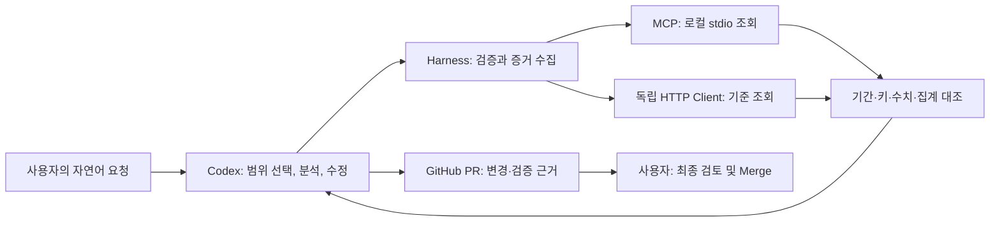

# WhaTap AI Agent Harness v2

Codex가 WhaTap MCP를 검수하고 필요한 수정만 GitHub PR로 제출하는 과제 프로젝트입니다. Harness는 MCP가 출력한 데이터를 별도 HTTP Client의 결과와 비교해 판정과 재현 근거를 남깁니다. 사용자는 PR에서 변경 이유와 검증에 사용한 데이터를 확인한 뒤 Merge를 결정합니다.

## 주요 기능

- 서버 CPU·메모리, APM 트랜잭션·예외, TPS·오류 시계열 등 9개 시나리오 검증
- Codex가 요청에 맞춰 시나리오를 선택하고 원인 분석, 수정, 테스트 및 재검증 수행
- 한국어 보고서, 원본 JSON 증거, 검증 전후 비교표와 PR 검토 근거 생성
- 승인된 실제 표본만 가명 처리해 게시하고 원본 응답은 로컬에 보존

## 동작 흐름



## Quick Start

**사용자 준비.** Linux에서 Bash, Git, Node.js 22와 npm, GitHub CLI, Codex CLI를 준비합니다. 본인의 MCP Fork와 읽기 전용 WhaTap 데모 권한이 필요합니다. 처음 설치하는 경우 [설치 가이드](docs/installation.md)에 따라 Clone, 인증, 기준 브랜치와 데모 설정을 완료하세요.

**Harness 저장소 루트에서 확인하고 시작합니다.**

```bash
npm test
node verify.js --list
codex --sandbox workspace-write --ask-for-approval on-request
```

Codex에 다음과 같이 요청할 수 있습니다.

> 원본 MCP 전체를 검수하고, 재현되는 문제가 있으면 수정·재검증해서 내 Fork에 PR로 제출해 줘.

> APM 트랜잭션과 TPS의 데이터 정확성을 독립 HTTP 결과와 비교해 줘.

**Codex가 수행하는 작업.** 승인된 작업 범위에서 기준과 후보의 빌드·테스트, MCP와 HTTP 조회, 원인 분석, 변경 및 보고서 생성을 진행합니다. 변경할 문제가 확인되면 대상 저장소의 작업 브랜치로 검토용 PR을 제출합니다.

**사용자가 확인하는 결과.** GitHub PR의 변경별 반영 근거, 검증 전후 판정과 승인된 비교표를 확인합니다. 로컬 상세 보고서와 JSON은 실행 출력에 나온 경로에서 열 수 있습니다. 최종 Merge는 사용자가 수행합니다.

## 실제 데이터 공개 설정

기본 설정에서는 PR에 시나리오별 판정이 표시되며 실제 측정값과 상세 비교 통계는 제외됩니다. 공개 권한이 확인된 경우에만 Harness 루트의 선택 설정인 `publication.local.json`으로 승인된 비교 표본과 통계를 포함할 수 있습니다. 승인 범위와 설정 방법은 [데이터 공개 설정](docs/reporting.md#데이터-공개-설정)을 참고하세요.

## 상세 문서

| 문서 | 내용 |
| --- | --- |
| [설치 및 환경 구성](docs/installation.md) | 프로그램, GitHub Fork·브랜치, 데모 프로젝트와 토큰, 최초 실행 |
| [사용 가이드](docs/usage.md) | 요청 예제, 직접 검증, 실패 대응, PR 검토 |
| [아키텍처와 검증 정책](docs/architecture.md) | 구조, 판정, 보안, 설계의 한계 |
| [보고서와 PR 제출](docs/reporting.md) | 산출물, 매니페스트, 공개 정책, 증거 재생성 |
| [실제 실행 기록](docs/execution.md) | 성공·실패 사례, 커밋, PR, 보존된 실행 ID |
| [Agent 작업 지침](AGENTS.md) | 저장소를 열었을 때 Codex가 따르는 작업 규칙 |

실데이터 검증에는 승인된 데모 접근과 네트워크가 필요합니다. 도구가 보여 주는 데이터와 요약을 검증하며, 자유 형식 AI 응답의 정확성이나 등록 시나리오 밖의 MCP 기능은 별도 검증이 필요합니다.
