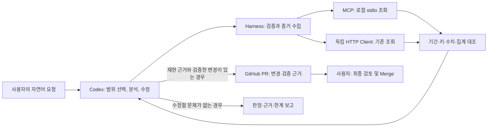

# WhaTap AI Agent Harness v2

WhaTap AI Agent Harness는 WhaTap MCP를 실행하고, 도구가 반환하는 기간·행·수치·집계를 독립 WhaTap HTTP API 응답과 비교합니다. Codex와 함께 사용하면 문제의 원인을 분석하고, 수정 후보를 재검증해 GitHub 검토용 PR을 만들 수 있습니다.

## 주요 기능

- 서버 CPU·메모리, APM 트랜잭션·예외, TPS·오류 시계열 및 잘못된 입력 처리까지 기본 시나리오 6개 검증
- 정해진 서버 CPU 질문에 대한 Codex의 구조화 답변을 독립 HTTP로 별도 검증
- Codex가 요청에 맞춰 시나리오를 선택하고 원인 분석, 수정, 테스트 및 재검증 수행
- 한국어 보고서, 원본 JSON 증거, 검증 전후 비교표와 PR 검토 근거 생성
- 승인된 실제 표본만 가명 처리해 게시하고 원본 응답은 로컬에 보존

## 동작 흐름



## Quick Start

1. [설치 가이드](docs/installation.md)에서 Ubuntu 도구를 준비하고 Harness를 Clone합니다. Harness 실행에는 Bash, Git, Node.js 22 계열(최신 패치 권장)이 필요합니다. MCP 빌드에는 npm, Codex 작업에는 Codex CLI와 Linux 샌드박스, Fork 및 PR 작업에는 GitHub CLI와 해당 저장소 권한이 필요합니다.
2. **Harness 루트**에서 서비스 자격 증명 없이 설치 상태를 확인합니다.

   ```bash
   npm test
   node verify.js --list
   ```

3. 실제 검수에는 빌드한 MCP, 승인된 Server·APM 프로젝트와 두 읽기 전용 토큰이 필요합니다. [직접 검증](docs/usage.md#직접-검증)으로 시나리오를 실행하거나, 같은 루트에서 `codex --sandbox workspace-write --ask-for-approval on-request`를 열어 요청합니다.

   > APM 트랜잭션과 TPS를 독립 HTTP 결과와 비교하고, 변경 없이 결과만 알려 줘.

   > MCP 전체 기능을 검수하고 재현된 결함의 수정안을 내 Fork에 검토용 PR로 만들어 줘.

4. 실행 출력에 표시된 `runs/<실행 ID>/report.md`에서 판정과 실패 사유를, `report.json`에서 로컬 원본 근거를 확인합니다. GitHub PR을 만들 경우 생성한 PR 본문에서 변경 이유와 승인된 비교표를 검토합니다.

## 실행 예시와 지원 범위

[MCP PR #9](https://github.com/jtlim/whatap-open-mcp/pull/9)에서 검증 전후 판정, 변경 이유, 비교 근거와 재현 절차가 포함된 실제 PR을 볼 수 있습니다. 이 PR은 이전 Harness가 고정 구간을 기본 배치에 포함했을 때의 실행 사례입니다. [실행 예시와 실패 기록](docs/execution.md)

전체 검수는 기본 MCP 시나리오 6개와 서버 CPU 구조화 AI 답변 검증을 포함합니다. 기본 조회는 상대시간으로 요청하고, 검증한 응답 Period를 독립 HTTP에 전달합니다. 절대시간 등 기능별 검증은 요청 범위와 도구의 지원 여부에 따라 별도로 실행합니다. 등록되지 않은 MCP 도구와 자유 형식 AI 답변은 별도 검증이 필요하며, 데이터 완전성과 권한에 따라 일부 결과는 검증 불가로 남을 수 있습니다.

## 상세 문서

| 문서 | 내용 |
| --- | --- |
| [설치 및 환경 구성](docs/installation.md) | 프로그램, GitHub Fork·브랜치, 데모 프로젝트와 토큰, 최초 실행 |
| [사용 가이드](docs/usage.md) | 요청 예제, 직접 검증, 실패 대응, PR 검토 |
| [아키텍처와 검증 정책](docs/architecture.md) | 구조, 판정, 보안, 설계의 한계 |
| [보고서와 PR 제출](docs/reporting.md) | 산출물, 매니페스트, 공개 정책, 증거 재생성 |
| [실행 예시와 실패 기록](docs/execution.md) | PR 결과물 읽는 방법과 실패 처리 예제 |
| [Agent 작업 지침](AGENTS.md) | 저장소를 열었을 때 Codex가 따르는 작업 규칙 |
